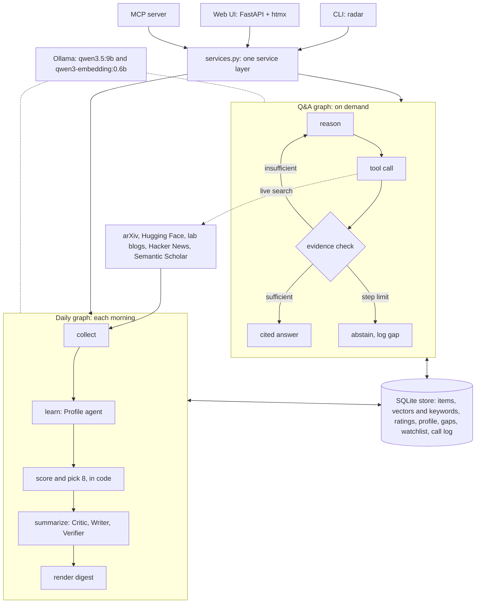

# AI Research Radar

A personal research agent that keeps one practitioner current on AI. Every morning it collects
new papers and lab announcements, ranks them against your interests, and writes a digest of the
eight worth reading. You can ask it follow-up questions and get answers that cite specific papers,
or an honest "I couldn't find enough evidence" when the store doesn't support an answer.

It runs on a laptop: the language model (Qwen 3.5 9B) and the embedding model run locally
through [Ollama](https://ollama.com), the data lives in one SQLite file, and the only cloud
service is optional tracing in [LangSmith](https://smith.langchain.com). The project calls this
**local inference, cloud tracing**.

- **Who it's for:** an individual engineer or researcher who wants to follow AI research without
  reading hundreds of arXiv abstracts a day.
- **What it does:** a daily ranked digest with grounded summaries, cited question answering, a
  feedback loop from your ratings, and three ways to use it: a CLI, a local web UI and an MCP
  server.
- **What's in this repo:** the full source (`src/radar/`), 238 offline tests (`tests/`), the
  evaluation question set, scripts and result files (`evals/`), sample outputs
  (`docs/examples/`), the build plan ([PLAN.md](PLAN.md)) and the design rules
  ([CLAUDE.md](CLAUDE.md)).

## Contents

1. [Architecture](#architecture)
2. [Setup](#setup)
3. [Quick start](#quick-start)
4. [Usage: CLI, web UI and MCP](#usage)
5. [Evaluation and results](#evaluation-and-results)
6. [Safety and human oversight](#safety-and-human-oversight)
7. [Tests and CI](#tests-and-ci)
8. [Reviewing the code](#reviewing-the-code)
9. [Limitations](#limitations)

## Architecture



**Two LangGraph graphs do the work.**

- **The daily graph** is a fixed pipeline: `collect → learn → candidates → score → pick →
  summarize → render → recheck_watchlist`. Ranking is a deterministic scoring function in code
  (relevance to your interest profile, Hugging Face upvotes and Hacker News points, citation
  velocity, recency), never the LLM. Of the eight picks, two slots are reserved: one for an
  "early buzz" paper (lots of attention, few citations yet) and one for a lab launch. Only the
  summarize step and the Profile agent call the model.
- **The Q&A graph** is a ReAct loop with an explicit evidence check (exported from the compiled
  graph):

  ```mermaid
  graph TD;
      begin([start]) --> prepare --> rewrite_query --> reason --> tools --> evidence_check;
      evidence_check -. insufficient .-> reason;
      evidence_check -. sufficient .-> answer --> verify --> done([end]);
      evidence_check -. step limit .-> abstain --> done;
  ```

  The agent searches the store (hybrid vector and keyword search), falls back to live arXiv and
  Semantic Scholar, and reads a paper's full text once two answers have cited it. Every claim
  needs a `[paper_id]` citation, and citations to papers it didn't retrieve are deleted. After
  five tool calls without enough evidence it abstains and logs the question as a gap, which the
  next collection run searches for. `verify` runs only with `--verify` or `VERIFY_ANSWERS=true`.

**Five LLM agents, one code supervisor.** All are the same local Qwen with different prompts.

| Agent | Where | Job |
|---|---|---|
| Q&A agent | Q&A graph | Chooses tools and queries, answers from retrieved passages |
| Critic | digest team | Keeps or drops each pick (off-topic, no substance); a drop is refilled from the same slot |
| Writer | digest team | Writes a 2-3 sentence cited summary; rewrites only the claims the Verifier rejected |
| Verifier | digest team and Q&A | Judges each claim against its source; unsupported claims are rewritten (2 tries), then cut |
| Profile agent | daily `learn` step | Proposes interest-topic changes from your ratings and unanswered questions (guarded; removals need your approval) |

The digest team is a LangGraph supervisor graph whose router is plain code: it enforces the
retry limit (2 rewrites per item) and the drop limit (3 per digest, so the Critic can't empty
the digest). `DIGEST_MODE=single` replaces the team with one summarizer call per pick.

**Memory.** Short-term memory is the graph state, persisted per conversation with LangGraph's
SQLite checkpointer so follow-up questions resolve. Long-term memory is the project's own SQLite
store: items, ratings, the interest profile (a Rocchio-style vector plus scoring weights nudged
by ratings), questions and gaps, and the early-buzz watchlist, which re-checks citations after
two to four weeks.

**One service layer, three front ends.** `services.py` holds every operation (ask, daily,
search, rate, profile, health and so on). The CLI, the web UI and the MCP server are thin
wrappers over it, so all three behave the same.

### Repository layout

```
src/radar/
  cli.py              Typer CLI (`radar ...`)
  services.py         the operations every front end calls
  config.py           settings from .env (pydantic-settings)
  models.py           chat and embedding model factory (Ollama); tests swap in fakes
  graphs/
    qa.py             Q&A ReAct graph with evidence check, abstain and verify
    daily.py          daily digest pipeline
    prompts.py        all prompts in one place
    agents/           critic.py, writer.py, verifier.py, profile.py, team.py (the supervisor)
  rag/                chunking, hybrid retrieval (RRF), VectorIndex with sqlite-vec and LanceDB
  sources/            arxiv, hf_papers, semantic_scholar, lab_blogs, hackernews, full_text
  tools/              LangChain tools the agent calls (also exposed over MCP)
  store/              SQLite access and numbered SQL migrations (001-009)
  scoring.py          the ranking function (pure, unit-tested)
  feedback.py, personalize.py   ratings -> weights, reserved slots, profile vector, watchlist
  safety.py           injection scan, review flags, Critic agreement
  tracing.py          @traced: LangSmith runs plus a local tool_calls log
  evals.py, evals_agents.py     eval suite and the single vs multi-agent comparison
  mcp_server.py, mcp_client.py  MCP server and client
  schedule.py         launchd job for the morning digest (macOS)
  web/                FastAPI app, routes, Jinja2 templates, vendored htmx and Pico CSS
tests/                pytest suite with recorded fixtures and scripted fake models
evals/                questions.jsonl, hand_check.py, results/
docs/examples/        sample digests and a sample answer from real runs
```

## Setup

The project was built and run on a 16 GB M3 MacBook Air (macOS). Everything except the
launchd scheduler should also work on Linux.

**Requirements**

- [uv](https://docs.astral.sh/uv/) (installs Python 3.12 and the dependencies)
- [Ollama](https://ollama.com), running locally
- About 7 GB of disk for the two models, plus a few hundred MB for the store
- Optional: a LangSmith API key (tracing and eval experiments) and a Semantic Scholar API key
  (steadier rate limits)

**Install**

```bash
git clone https://github.com/priyankaganesan/ai-research-radar.git
cd ai-research-radar

ollama pull qwen3.5:9b               # chat model, about 6 GB at 4-bit
ollama pull qwen3-embedding:0.6b     # embedding model

uv python install 3.12
uv sync
cp .env.example .env                 # every setting is documented in this file
uv run radar init-db                 # creates data/radar.db and applies the migrations
uv run radar health                  # checks the database, Ollama and both models
```

Settings live in `.env`, which is never committed. The defaults work as they are. The ones you
are most likely to change:

| Setting | Default | What it does |
|---|---|---|
| `OLLAMA_HOST` | `http://127.0.0.1:11434` | where Ollama listens |
| `CHAT_MODEL` | `qwen3.5:9b` | use `qwen3.5:4b` on a smaller machine |
| `LANGSMITH_TRACING`, `LANGSMITH_API_KEY` | `true`, empty | without a key, tracing turns itself off and the agent works the same |
| `INTEREST_TOPICS` | agents, RAG, reasoning, efficient inference, evaluation | seed topics for relevance |
| `DIGEST_MODE` | `single` | `multi` uses the Critic, Writer and Verifier |
| `VERIFY_ANSWERS` | `false` | run the Verifier on every Q&A answer |
| `VECTOR_BACKEND` | `sqlite` | `lance` after `radar reindex --backend lance` |

## Quick start

```bash
uv run radar ingest all              # arXiv, Hugging Face, lab blogs, Hacker News, then Semantic Scholar
uv run radar daily                   # writes data/digests/YYYY-MM-DD.md
uv run radar digest                  # prints it
uv run radar ask "How does Medusa speed up decoding?" --steps
uv run radar serve --open            # the web UI at http://127.0.0.1:8000
```

Expect it to be slow. On the M3 Air a digest takes 2 to 10 minutes and an agentic question
several minutes, almost all of it Qwen generating text. The first `ingest all` fetches and embeds
a week of papers.

## Usage

### CLI

`uv run radar --help` lists every command, and each command has its own `--help`.

```bash
# Collect
uv run radar ingest --days 3          # recent arXiv papers (cs.AI, cs.CL, cs.LG), embedded
uv run radar ingest hf|labs|hn|all    # Hugging Face Daily Papers, lab blogs, Hacker News, or all of them
uv run radar enrich                   # Semantic Scholar citation counts and TLDRs
uv run radar show 2401.10774          # one item with its TLDR and signals

# Digest
uv run radar daily                    # collect, learn, rank, summarize, write the digest
uv run radar daily --no-collect       # build from the store as it is (faster)
uv run radar daily --mode multi       # Critic, Writer and Verifier write the summaries
uv run radar digest [--date D] [--open]
uv run radar rate 2611.06741 useful   # useful | not_relevant | skipped; applied at the next run
uv run radar profile                  # topics, scoring weights, reserved slots, recent changes
uv run radar profile --approve 1      # approve a topic removal the Profile agent proposed
uv run radar watchlist                # early-buzz papers waiting to earn citations
uv run radar gaps                     # questions the agent couldn't answer yet

# Ask
uv run radar search "speculative decoding"       # retrieval only, no LLM
uv run radar ask "..." --steps                   # show each step of the loop
uv run radar ask "..." --verify                  # the Verifier checks each claim of the answer
uv run radar ask "..." --no-retrieval            # same model, no tools: the baseline
uv run radar fulltext 2401.10774 -q "how are the heads trained"   # search inside one paper

# Schedule (macOS)
uv run radar schedule install --at 07:30 [--mode multi]   # launchd runs `radar daily` each morning
uv run radar schedule status|run|remove

# Look under the hood
uv run radar health                   # database, Ollama and both models reachable?
uv run radar calls [--tree last] [--errors] [--stats]    # local log of every traced call
uv run radar sources                  # what each source returned lately; warns on quiet sources
uv run radar flagged [--release ID]   # items held back for instruction-like text
uv run radar critic                   # how often the Critic agrees with your ratings

# Evaluate
uv run radar eval --local                         # retrieval recall@5 and MRR (fast)
uv run radar eval -t all --judge --local          # plus the full agent and the no-retrieval baseline (slow)
uv run radar eval -t agent -m qwen3.5:9b -m qwen3.5:4b   # compare chat models
uv run radar compare-agents --date 2026-11-08     # single vs multi-agent digest (about 20 min)
uv run radar compare-backends                     # sqlite-vec vs LanceDB
```

### Web UI

```bash
uv run radar serve --open             # http://127.0.0.1:8000, Ctrl-C stops it
```

A server-rendered FastAPI app with htmx and no JavaScript of its own; htmx and Pico CSS are
vendored, so it works offline. Pages: **Today** (the digest by slot, rating buttons, the "needs
review" banner, the Critic's drops), **Ask** (the agent's steps stream live over Server-Sent
Events, then the answer with linked citations, the sources it read and the Verifier's table;
follow-ups continue the conversation), **Search**, **Item**, **Profile** (approve or reject topic
removals), **Watchlist**, **Gaps**, **Library** and **System** (health, sources, flagged items,
the call log as a tree, Critic agreement). Long work runs as background jobs, one at a time,
because Ollama generates one response at a time. The app listens on localhost only and checks
the Host and Origin of every request.

### MCP server

`radar mcp` is a [Model Context Protocol](https://modelcontextprotocol.io) server over stdio, so
MCP clients such as Claude Code or Claude Desktop can use the research store. It offers:

- **Tools:** `store_search`, `search_arxiv`, `semantic_scholar_lookup`, `fetch_full_text`,
  `get_item`, `ask`, `rate`
- **Resources:** `radar://digest/latest`, `radar://stats`, `radar://watchlist`, `radar://profile`
- **Prompt:** `explain_paper`

The tools are defined once in `src/radar/tools/` and shared by the agent and the server. With
`TOOLS_VIA_MCP=true`, `radar ask` loads its own tools through the server, which shows the
protocol end to end.

The checked-in `.mcp.json` points at the author's paths. Replace both paths with yours (the
output of `which uv`, and the repo folder), or register the server with the CLI instead:

```bash
claude mcp add radar -- uv run --directory /path/to/ai-research-radar radar mcp
npx @modelcontextprotocol/inspector uv run --directory /path/to/ai-research-radar radar mcp   # inspect it by hand
```

For Claude Desktop, add this to `~/Library/Application Support/Claude/claude_desktop_config.json`:

```json
{
  "mcpServers": {
    "radar": {
      "command": "/absolute/path/to/uv",
      "args": ["run", "--directory", "/path/to/ai-research-radar", "radar", "mcp"]
    }
  }
}
```

## Evaluation and results

Every number here can be reproduced with the commands above; result files go to
`evals/results/`.

| What | How it's measured | Result | File |
|---|---|---|---|
| Single vs multi-agent digest (two runs, same day's picks) | Every final claim judged against its source | Claim support 93% and 100% (single) vs 100% and 100% (multi); 8 vs 31 model calls; 53-65 s vs 326-404 s | `evals/results/agents-20261108-*.md` |
| Verifier on Q&A answers | The same 8 questions with and without `--verify` | Raised claim support from 75% to 100% on 2 of 5 answered questions; both modes abstained on 3 | `evals/results/agents-20261108-2222.md` |
| Vector backends | 50 queries against exact search | sqlite-vec exact at 0.6 ms p50; LanceDB IVF-PQ recall 0.87, 1.00 with refine | `evals/results/backends-*.md` |
| Retrieval | recall@5 and MRR on 16 questions with known answer papers | recall@5 100%, MRR 0.88, 0.1 s per question | `evals/results/eval-20261122-1708.md` |
| Abstention | 3 questions the store can't answer (`evals/abstain.jsonl`) | not yet run as an eval; a real refusal is in `docs/examples/answer-abstain.md` | `radar eval -t agent --file evals/abstain.jsonl` |
| Judge reliability | A person labels claims blind; agreement and Cohen's kappa against the Qwen judge | On content, 14 of 15 agree (93%); when every claim must be cited, 12 of 15 (80%), judge 93% vs human 87%: the judge doesn't check for missing citations | `evals/results/hand-check-20261122-1540-v2-agreement.md` |
| Critic agreement | The Critic's keep/drop against the user's ratings of the same items | `uv run radar critic` | local store |

**Read the claim-support numbers as upper bounds.** The judge is the same Qwen model that wrote
the summaries, so it may share their blind spots. `evals/hand_check.py` measures that: it exports
claims with the source text the judge saw, keeps the judge's verdicts in a separate file while a
person labels the claims, then reports agreement and Cohen's kappa:

```bash
uv run python evals/hand_check.py export --pick 3,4,6 --fast   # a .md to read and a .csv to fill in
uv run python evals/hand_check.py agree evals/results/hand-check-*.csv
```

The question set is `evals/questions.jsonl`: 16 questions with the IDs of the papers that answer
them, and 3 that should be refused. With a LangSmith key, `radar eval` syncs it to a LangSmith
dataset and runs each target and model as an experiment.

## Safety and human oversight

The agent only reads public sources and writes to its own database, so the main risk is
misleading text, not harmful actions. Where a rule can be checked in code, code enforces it.

- **Grounding:** citations to unretrieved papers are deleted; the Verifier checks claims;
  unsupported claims are rewritten, then cut with a note; the Q&A agent abstains instead of
  guessing.
- **Inputs:** source text is wrapped in `<source>` tags that prompts declare to be data, not
  instructions; a scan holds back items whose text reads like instructions (`radar flagged`);
  title-only posts and low-relevance items can't take main digest slots.
- **Limits:** 5 tool calls per question, 2 rewrites per summary, 3 Critic drops per digest, and
  at most 2 topic additions and 1 removal per Profile agent run.
- **Human oversight:** a digest opens with a "needs review" banner when Verifier support falls
  below 80%, more than two summaries lost claims, the Critic hit its limit, items were held, or a
  source went quiet. Topic removals wait for your approval (CLI or web UI, deliberately not an
  MCP tool). The morning job ends with a notification.
- **Audit:** every service call, source fetch and MCP call is traced to LangSmith and to a local
  `tool_calls` table that works offline (`radar calls --tree last`).
- **Web UI:** bound to 127.0.0.1, with a trusted-host check, a same-origin check on every POST,
  and autoescaped templates.
- **Source terms:** LinkedIn and IEEE Xplore are not used, because their terms forbid this use.

## Tests and CI

```bash
uv run pytest            # 238 tests; they never call Ollama, LangSmith or the network
uv run ruff check . && uv run ruff format --check .
```

Tests use recorded fixtures for every source and LangChain's scripted fake chat models for every
agent, so they run on any machine. GitHub Actions (`.github/workflows/ci.yml`) runs the lint,
the format check and the tests on every push and pull request.

## Reviewing the code

A suggested reading order:

1. `graphs/qa.py`: the ReAct loop, evidence check, abstain path and citation guard.
2. `rag/retrieve.py`: hybrid search with reciprocal rank fusion.
3. `graphs/daily.py` and `scoring.py`: the daily pipeline and the ranking function.
4. `graphs/agents/team.py`: the code supervisor over the Critic, Writer and Verifier.
5. `feedback.py` and `personalize.py`: how ratings change the next digest.
6. `safety.py`: the injection scan, review flags and Critic agreement.
7. `services.py`: the layer every front end calls.
8. `tests/test_agents.py` and `tests/test_qa_graph.py`: how agents are tested with scripted models.

Sample outputs from real runs are in [`docs/examples/`](docs/examples/): a single-agent digest,
a multi-agent digest that raised the "needs review" banner, and an abstention.

## Limitations

- **Slow on a laptop.** A question takes several minutes and a multi-agent digest 5 to 10
  minutes, nearly all of it Qwen generation; Ollama runs one generation at a time.
- **Same-model judge.** Claim-support numbers come from the same Qwen; the hand-check measures
  how far to trust them.
- **Citations are per paper, not per passage.** A `[paper_id]` says which paper supports a
  claim, not which section of it.
- **Small samples.** The question set has 19 questions, and Critic agreement rests on a handful
  of ratings.
- **macOS scheduling.** The morning job uses launchd; on Linux, run `radar daily --scheduled`
  from cron.
- **Single user, local only.** No accounts or remote access, by design.

See [PLAN.md](PLAN.md) for the full design and the ideas not yet built (a reranker, a pgvector
backend, a cloud ingest pipeline).
